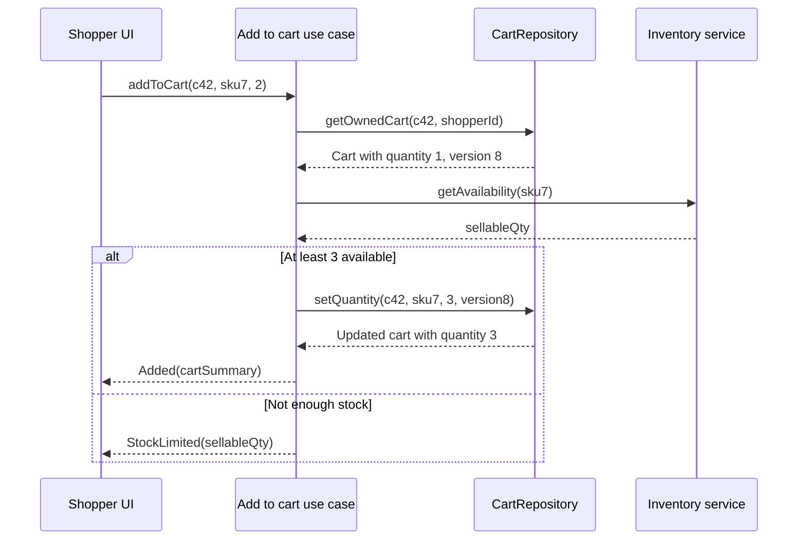

## When to use

When someone asks how one use case, request, or workflow actually runs: who calls whom, in what order, what data crosses each boundary, and what happens on success or failure. This is a standalone skill. Use <mention url="https://app.notion.com/p/4149439f148681c0970ed2e72ecbca08">Layered diagrams 3 · Inside-a-module sequence</mention> instead when the question is specifically about the internals of one module in the layered diagram set.

## Inputs

- One concrete use case and an entry point or trigger.
- For existing behavior: the relevant code, design, or trace and its version. For a proposed design: the intended boundaries and dependencies. Label assumptions and unverified paths rather than filling them in.

## Steps

1. State the user goal and where the trace starts and ends. The use case sets the scope; the architecture determines the participants.
2. Follow the real call path. Give callers, use cases, repositories, databases, external services, queues, or workers their own lifelines only when they actually participate and the handoff matters. Do not require a fixed count or a standard set of lanes. A participant is not necessarily an architectural layer.
3. Put calls in order. Label meaningful arrows with the actual method and key inputs, then show the result, state change, or payload transformation. Use clearly labeled pseudo-methods for a proposed design or when simplifying names for a product audience. Collapse helpers that do not change the story.
4. Show the main path and important alternatives with `alt` or `opt`. Distinguish synchronous replies from queued work and callbacks. For example, “order canceled, refund pending” is not “refund completed.”

## Output

A Mermaid `sequenceDiagram` titled for the use case, with a one-sentence scenario and source links for an existing implementation. Use solid arrows for calls and dashed arrows for replies. Default to the application boundary; show the HTTP layer, persistence details, or module internals when they explain a material handoff.

### Worked example: Add to cart (illustrative architecture)

The cart contains one unit; the shopper asks for two more. This storefront checks a separate inventory service but does not reserve stock on add.

If inventory were local, do not add an external-service lifeline to match this example. If a worker owns a later step, show that boundary only when it is in scope.

## Done checklist

- [ ] Every lifeline and handoff is supported by the actual architecture or clearly labeled as proposed.
- [ ] One scenario shows key inputs, outputs, state changes, and meaningful branches without implementation noise.
- [ ] The diagram explains the interaction; it does not claim that tests or a production trace verified anything unless they did.
