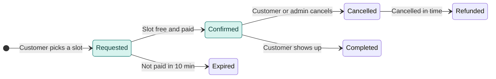

## Question this level answers

What states does the main thing in this feature go through, and what moves it from one state to the next? Examples of the main thing: a booking, an order, a lead, an invoice.

It does NOT show modules, patterns or who calls whom. Levels 2 and 3 cover that.

## Inputs

- The feature or PRD module, plus the worked example the router picked.
- If a PRD exists, take states and rules from it. Never invent business rules. Mark unknowns with ⚑ in the caption.

## Steps

1. Name the main thing. If there are two candidates, pick the one the customer cares about.
2. List its states as plain nouns or adjectives: Requested, Held, Confirmed, Cancelled, Refunded, Expired.
3. For each arrow, write the trigger in plain words: "Customer pays", "Not paid in 10 min", "Admin cancels".
4. Include the unhappy paths: expired, failed, cancelled, no-show and so on.
5. Pick the one path that Level 2 will open up, usually the happy path that creates the thing. Highlight it.

## Diagram rules

- Mermaid `stateDiagram-v2`, `direction LR`.
- 10 states at most. If there are more, group them and say so in the caption.
- Every transition has a label. No technical words: no `status=2`, no event names.
- Highlight the Level 2 path with one `classDef focus` and nothing else coloured.

## Section output

- Kicker: "Level 1 · State machine".
- Heading: "The life of a \<thing>".
- One caption sentence: how to read it, and which path Level 2 opens up.

## Done when

- [ ] Every state is reachable and every non-final state has a way out.
- [ ] The highlighted path matches what Level 2 will show.
