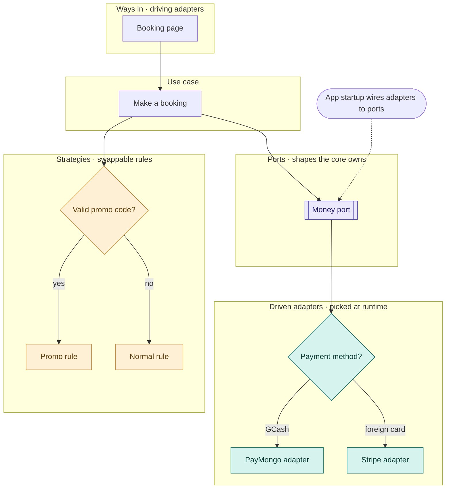

## Question this level answers

How is the design shaped? Where are the swap-in points, and where does the app choose between options while it runs?

This is a structure diagram, not a timeline. Do NOT draw the steps in order, because that repeats Level 1 or 3. The flowchart's strength is abstraction: layers, boundaries and decision points.

## Inputs

- The feature and the worked example from the router.
- The Level 1 path being opened up, if Level 1 was drawn.
- The project's layering, if known. Default: Router → UseCase → Service → Repository, with vendors behind adapters.

## Steps

1. List the ways in: the pages, jobs and webhooks that start work. These are the driving adapters.
2. Name the use case or cases. They know the steps, not the vendors.
3. Find every rule that has more than one version, such as pricing, discounts, routing or scoring. Each one becomes a strategy, picked by one or more diamonds.
4. List what the core needs from outside: storage, money, messages, files, AI. Each one becomes a port.
5. Put the vendors behind each port. Wherever the vendor depends on the situation (payment method, region, customer preference), add a diamond. That is runtime adapter selection.
6. Add one "App startup wires adapters to ports" node with dotted arrows to the ports. This is the composition root.
7. Write the "What changes when the business changes" table: 3 to 5 realistic requests, what you add for each, and what stays untouched.
8. Note the module list. It feeds Level 3.

## Diagram rules

- Mermaid `flowchart TD` with one `subgraph` band per layer, in this order: Ways in (driving adapters) → Use case → Strategies → Ports → Driven adapters.
- Labels: plain words first, with the pattern name in the band title. For example, "Ports · shapes the core owns".
- Diamonds only for runtime choices. Label every branch: "GCash or Maya", "foreign card".
- Arrows from the use case stop at ports or the strategy picker. They never reach a vendor directly.
- Ports use the `[[...]]` shape.
- Exactly three colours, with a legend under the diagram: strategy amber, port purple, adapter teal.

## Section output

- Kicker: "Level 2 · Flowchart · Design patterns".
- Heading: "How the design is shaped".
- The caption, the diagram, the legend, then one sentence naming what a new rule or vendor would touch.
- The "What changes when the business changes" table.
- Optional: a collapsed TypeScript sketch of the port, strategy list and adapter choice, kept under 25 lines.

## Done when

- [ ] Every port has at least one adapter, and every diamond has labelled branches.
- [ ] No arrow goes from the use case straight to a vendor.
- [ ] The module list for Level 3 is written down.
