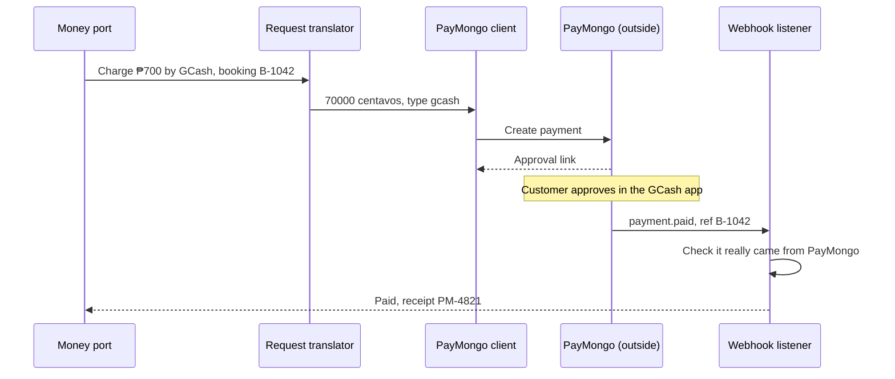

## Question this level answers

Inside one module, how do its parts work together? This is where the sequence diagram is strongest: who talks to whom, in what order, within a small boundary.

Do NOT redraw the end-to-end flow across all modules, because Level 2 already covers the shape. Each diagram stays inside one module, plus the port it sits behind and the outside vendor if it is an adapter.

## Inputs

- The module name or names. Take them from Level 2's module list or the user's request.
- The worked example from the router, with the same customer, numbers and vendors.
- No module named and no Level 2 list → name 3 or 4 candidates and ask which.

## Picking modules (when the user says "full")

Choose 3 or 4 that each teach something different:

- **A strategy module:** the rule list is walked, and one rule applies or falls through.
- **An adapter:** a request is translated out, the vendor is called, an async callback or webhook arrives, it is verified, and the result is translated back.
- **A guard module:** checks, holds, locks, timers or expiry.
- **An outbound module:** templates, channel choice, retry or fallback.

## Steps

1. List the module's subcomponents in plain names: "Request translator", "Rule list", "Slot hold timer". Use 4 to 7 participants.
2. Write one concrete scenario with one interesting twist, such as an expired promo code, a provider that is down, a webhook to verify, or a hold that times out.
3. Draw the messages in plain sentences with real values from the worked example.
4. Use `alt` for branches and `Note over` for anything that happens outside the timeline, such as "Maria approves in her GCash app".

## Diagram rules

- Mermaid `sequenceDiagram`, one per module, 12 to 16 messages at most.
- Participants are subcomponents, not layers. Give them pattern hints in brackets only when helpful: "Money port", "PayMongo (adapter)".
- Replies use dashed arrows (`-->>`).
- Show real formats only where the translation itself is the point, for example "₱700 → 70000 centavos".

## Section output

Per module:

- Kicker: "Level 3 · Sequence · Inside the \<module>".
- Heading: a plain question it answers, such as "How an adapter translates between us and the vendor".
- A one-sentence caption naming the scenario and the twist.

## Done when

- [ ] Each diagram stays inside one module's boundary.
- [ ] No two diagrams tell the same story.
- [ ] Values match the worked example used in Levels 1 and 2.
