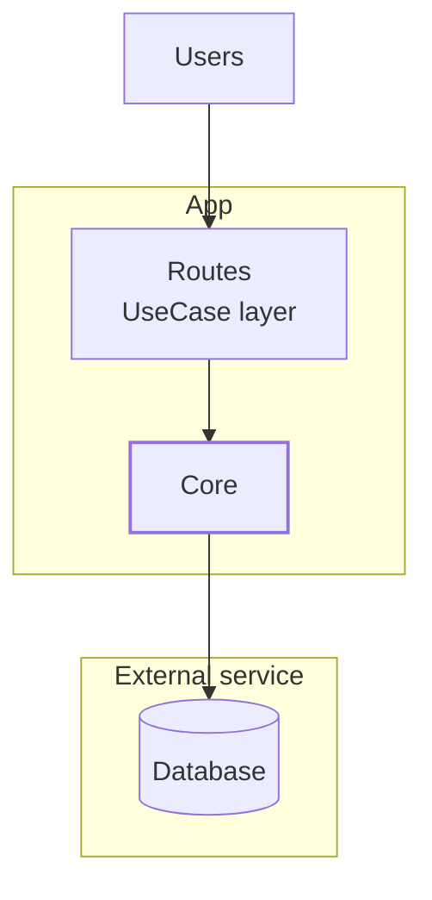

## When to use

Use when I ask to write up a design, architecture or integration as a page. Target: one page, one pass, done in about a minute.

Do NOT use for: project status or tasks (Projects), things to learn (Learning queue), proven knowledge (core notes).

## Inputs

- **The design:** from the conversation, a pasted doc, or a Source link. Required.
- **Source link** (optional): where the original lives, e.g. a Claude doc.
- **Destination:** default is a new row in <mention url="https://app.notion.com/p/de7daddde29a49f79b6e89b25575dd6f" /> (data source `collection://033442cf-d71b-4481-aeb1-e8247d4d39ac`). Use another place only if I name it.
- Missing the design itself → ask once. Missing anything else → use the defaults here, don't ask.

## Steps

1. Fetch the Blueprints data source to confirm its property names.
2. Write the whole page in your head first, following the outline below.
3. Create it with ONE create call: properties + full content together. Never create an empty page and fill it later.
4. Fetch the new page once to confirm the diagrams and tables saved.
5. Report back and hand off (see Handoff).

## Page outline (fixed order)

1. **Callout at top:** "Draft design, not built or validated." + Source link if given.
2. **Summary:** 2–3 sentences in plain product language. What it is and why.
3. **Architecture:** one Mermaid `flowchart`, then one sentence on how to read it.
4. **One section per concern** (e.g. Auth, Data, Storage, Integrations): lead sentence = the decision, then 3–6 bullets or a table. Add a `sequenceDiagram` only for a flow with branches or several parties.
5. **Implementation plan:** to-do list, each step with a "Check:" line that proves it works.
6. **Guardrails and open questions:** "Do not" bullets, then open questions marked ⚑.

## Diagram rules

- Mermaid code blocks only (Notion renders them natively). Max 3 diagrams per page.
- Architecture: `flowchart TB` with `subgraph` per system boundary (e.g. app, external service).
- Node labels: a name + at most 2 short lines, using `&lt;br/&gt;`.
- Highlight exactly one core node with a `classDef`; no other colours.
- Dotted arrows (`-.-&gt;`) only for optional or secondary paths.
- Example shape:

## Writing rules

- Plain product language first, technical detail after.
- Respect my layering: Router → UseCase → Service → Repository; vendors sit behind adapters.
- Sentences under 25 words. Bullets only for parallel items.
- Only facts from the inputs. Unknown → an open question with ⚑, never a guess.

## Never

- Run extra verification or modelling (formal checks, simulations, statecharts).
- Create subpages, extra databases or more than one page.
- Pull in material from other projects or pages that weren't given as inputs.
- Edit any page other than the one you create.

## Output

One row in Blueprints:

- **Name:** "\<System> — \<design name>"
- **Kind:** Architecture (or Spec / Research / Diagram)
- **Subject area:** from the Glossary taxonomy
- **Status:** Draft
- **Source:** the source link, if any
- **Summary:** one line

## Done checklist

- [ ] One page created, properties set, Status = Draft.
- [ ] Every Mermaid block renders (re-fetch shows them intact).
- [ ] No subpages; nothing else edited.
- [ ] Open questions marked ⚑.

## Handoff

Tell the Second Brain operator, using the handoff format in Agent protocol: what was added, the link, and every ⚑ item.
